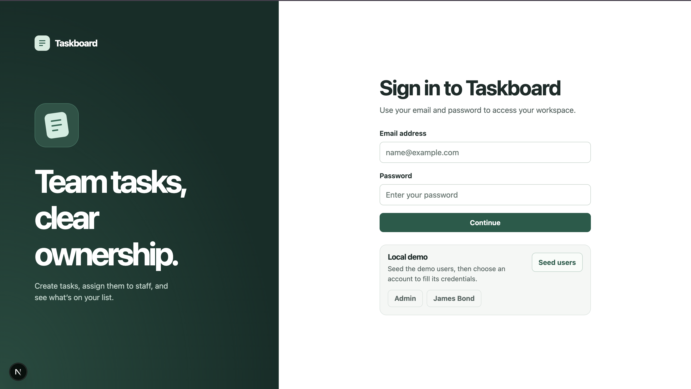
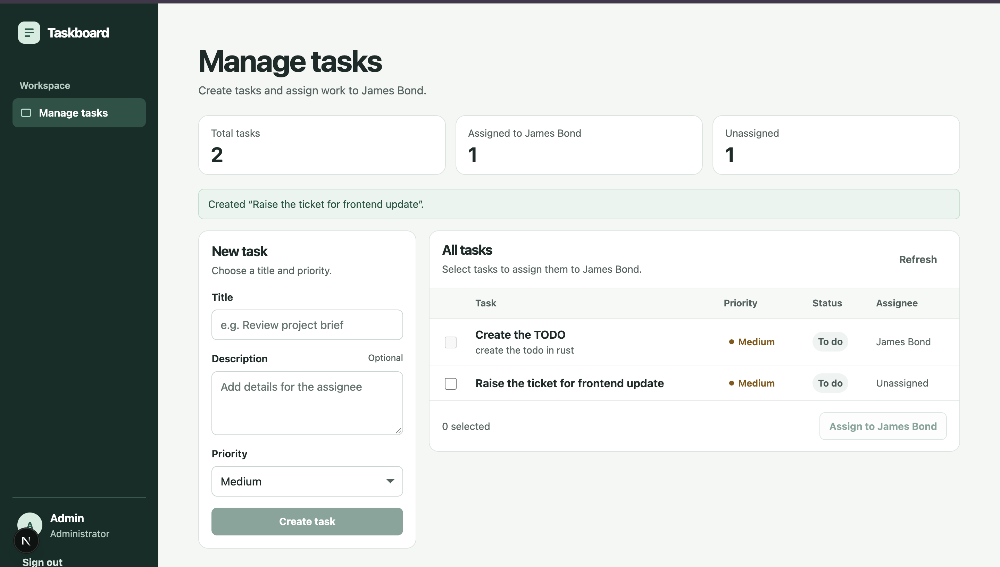
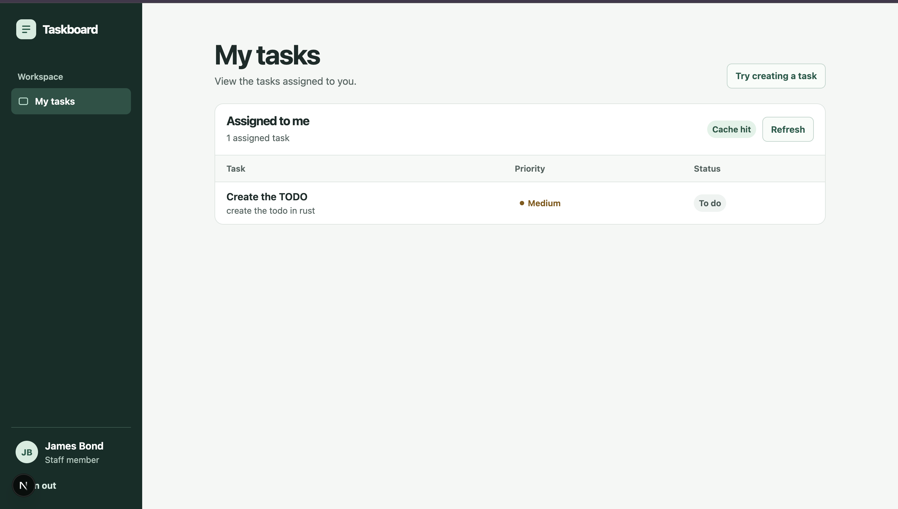
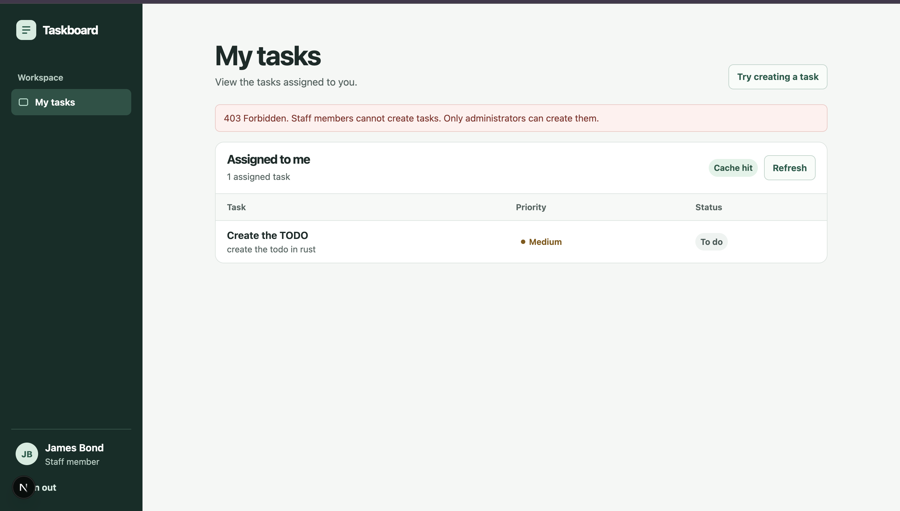
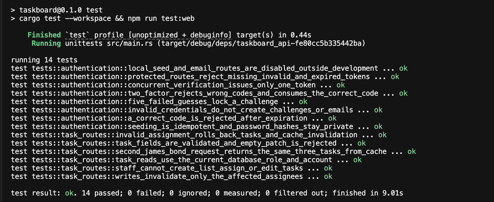

# Taskboard

Taskboard is a local task management app with a Next.js frontend and an Axum API. SQLite stores users, tasks, and login challenges. Next.js forwards same-origin `/api/*` requests to Rust.

## Run locally

Use Rust 1.91 or newer, Node.js 20.9 or newer, and a C toolchain for bundled SQLite. Run the commands from the repository root.

```sh
npm ci
```

Start the API in one terminal.

```sh
npm run dev:api
```

Start Next.js in another terminal and open [http://127.0.0.1:3000](http://127.0.0.1:3000).

```sh
npm run dev:web
```

| User | Email | Local demo password |
| --- | --- | --- |
| Admin | `admin@example.com` | `AdminPass123!` |
| James Bond | `jamesbond@example.com` | `JamesBond123!` |

## Validate in the browser

1. Click **Seed users**, select **Admin**, then click **Continue**.
2. Click **Read local email code**, then **Verify and sign in**.
3. Create five tasks. Give the three you plan to assign one high, one medium, and one low priority.
4. Select those three tasks in the table and click **Assign to James Bond**. The dashboard should show five total tasks, three assigned to James Bond, and two unassigned.
5. Sign out and repeat the two-step login for **James Bond**.
6. Confirm **My tasks** shows exactly the three assigned rows. Click **Try creating a task** to see the API's `403 Forbidden` result. Click **Refresh** to see **Cache hit**.

The demo controls use the same API endpoints available through curl. The JWT is held in React state for the current page session. A full page reload signs the user out.

## Screenshots

These screens show a two-task demo. The automated validation covers five created tasks and three assigned to James Bond.

### Sign in



### Admin workspace



### James Bond’s assigned tasks



### Staff creation denied



## Validate using HTTP

Use a fresh SQLite file. To run the HTTP validation independently of the browser flow, start the API with a separate path.

```sh
DATABASE_PATH=data/validation.sqlite3 npm run dev:api
```

In a second terminal run:

```sh
npm run validate --silent
```

The script seeds the users, verifies that passwords and codes are required, rejects an incorrect and a reused code for each user, creates five tasks, assigns three, and checks staff permissions. It prints the two actual James Bond responses as `first` and `second`. Both must contain the same three assigned tasks. The first must have `cache.hit = false` and the second must have `cache.hit = true`. Use a new database filename to run the script again. You can sign in as James Bond in the browser against that same API to see the three rows created by the script.

To validate through the Next.js proxy while both services are running, set `VALIDATION_ORIGIN=http://127.0.0.1:3000/api`.

| Method and path | Access | Request or behavior |
| --- | --- | --- |
| `GET /health` | Public | Returns API readiness and the development mode flag. |
| `POST /seed/users` | Development | Idempotently creates the two demo users. |
| `POST /auth/login` | Public | `{"email":"…","password":"…"}` returns a challenge ID and expiry. |
| `GET /dev/email-logs/latest` | Development | Returns the latest unexpired code. Optional `email` or `login_challenge_id` query parameters select a message. |
| `POST /auth/verify-2fa` | Public | `{"login_challenge_id":"…","code":"…"}` returns the JWT and public user details. |
| `GET /tasks` | Admin | Returns all tasks. |
| `POST /tasks` | Admin | `{"title":"…","description":"…","priority":"high"}` creates a task with `todo` status. The description is optional. |
| `POST /tasks/assign` | Admin | `{"task_ids":["…"],"assignee_email":"jamesbond@example.com"}` assigns the selected tasks in one transaction. |
| `PATCH /tasks/{id}` | Admin | Updates any of `title`, `description`, `priority`, or `status`. |
| `GET /tasks/view-my-tasks` | Authenticated | Returns the caller's assigned tasks, the total count, and cache metadata. |

Protected routes take the header `Authorization: Bearer <access_token>`. For example:

```sh
curl -sS http://127.0.0.1:4000/tasks/view-my-tasks \
  -H "Authorization: Bearer ${JAMES_BOND_TOKEN}"
```

## Automated tests

Run the Rust API and frontend suites from the repository root.

```sh
npm test
```

The API suite sends requests through the Axum router with an isolated SQLite database per test. It covers login and code expiry, concurrent verification and replay, role permissions, input validation, assignment rollback, and per-user cache invalidation. The frontend suite checks API request handling with mocked responses and renders the task table and empty state. Both suites run without local servers.



Run just the James Bond cache test with this command.

```sh
cargo test second_james_bond_request_returns_the_same_three_tasks_from_cache
```

## Implementation

- **Authentication.** Passwords use Argon2id. Each challenge has a random six-digit code, five-minute expiry, and five verification attempts. SQLite stores a keyed digest of the code. A write transaction makes verification and challenge consumption atomic. JWTs expire after one hour. The API reads the current role from SQLite for each authenticated request.
- **Email.** Development mode exposes a bounded, in-memory email log. Plaintext codes exist in that log for local retrieval and are never persisted. Development routes require `APP_DEV_MODE=1` and a loopback API bind. Sign-in uses the local mail log and requires development mode.
- **Cache.** The API caches task lists per user in memory. A SQLite trigger advances the affected users' task-list versions inside the same transaction as an assignment or task edit. Each authenticated request reads the current version with the user profile. A matching cache entry avoids the task-list query. The cache starts empty after each restart and each API process warms its own entries.
- **Source.** `apps/api/src/auth.rs` handles login and authorization. `apps/api/src/tasks.rs` handles task writes and reads. `apps/api/migrations` owns the schema. `apps/web/components` contains the screens and `apps/web/lib/api.ts` contains the typed HTTP client.

| Setting | Local default |
| --- | --- |
| `API_BIND` | `127.0.0.1:4000` |
| `API_ORIGIN` | `http://127.0.0.1:4000` in Next.js |
| `DATABASE_PATH` | `data/taskboard.sqlite3` |
| `APP_DEV_MODE` | Enabled by `npm run dev:api`. |
| `JWT_SECRET` | An ephemeral random key in development. Supply a secret of at least 32 bytes to retain tokens across restarts. |

Run `npm run typecheck` and `npm run build` for the web app, and `cargo check --workspace` for Rust.
